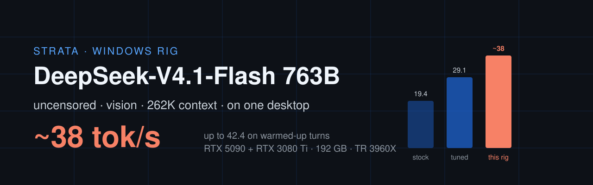

<p align="center"></p>

# Strata — experimental Windows rig build

**Status: experimental version.** Expect bugs, rough edges and breaking changes. This is a research
snapshot, not a stable or production-ready release. Test it in an isolated environment and keep backups.

**Author of the Windows rig patches, scripts, presets and documentation:** hap911
(<lvesely911@gmail.com>). Upstream Strata and third-party components remain credited to their
respective authors; this notice does not claim authorship of their work.

**A 763-billion-parameter model, uncensored, with vision, at 262K context — chatting at ~38 tokens
per second on a desktop PC.** No datacenter. No API bill. One RTX 5090, one RTX 3080 Ti, 192 GB of
RAM, and a pile of patches on top of [Strata](https://github.com/Niko1221/Strata).

This snapshot is the exact state my machine runs: **upstream Strata 0.2.8 / DeepSeek engine 0.1.54**
plus the patches below. The engine patches are included in this source snapshot; the Windows scripts,
presets and docs live in [`windows/`](windows/). Model weights are **not** in this repo — links below.
What changed in this update: [Notes — 2026-10-30](#notes--2026-10-30-upstream-028--engine-0154-cuda-graphs).

> [!WARNING]
> ## Legal disclaimer — authorized research only
>
> **This experimental software is provided solely for legitimate research, security testing and
> defensive work in environments that you own or have explicit permission to test.** If you do not
> own a system, obtain the system owner's authorization before testing it. Permission must cover the
> systems, data, accounts and activities involved.
>
> **Do not use this software or any model output to violate the law, breach computer systems,
> evade access controls, steal or expose data, harm people, infringe rights, or interfere with
> services.** This software is not a penetration-testing authorization, and no part of this
> repository grants permission to test any third-party system.
>
> Abliteration and uncensored operation can remove safety behavior. Model output may be harmful,
> unlawful, misleading or wrong. **You are responsible for reviewing output, applying appropriate
> safeguards, complying with applicable laws and third-party licenses, and for every consequence of
> your use.** Do not deploy this software in production, safety-critical systems or public-facing
> services without your own security review and controls.
>
> **THE SOFTWARE AND ANY GENERATED OUTPUT ARE PROVIDED "AS IS" AND "AS AVAILABLE", WITHOUT ANY
> WARRANTY OF ANY KIND, EXPRESS OR IMPLIED. TO THE MAXIMUM EXTENT PERMITTED BY APPLICABLE LAW, THE
> AUTHORS AND CONTRIBUTORS DISCLAIM ALL LIABILITY FOR ANY CLAIM, LOSS, DAMAGE, COST OR OTHER
> CONSEQUENCE ARISING FROM OR RELATED TO THEIR USE, MISUSE OR INABILITY TO BE USED. USE THEM
> ENTIRELY AT YOUR OWN RISK. IF YOU DO NOT ACCEPT THESE TERMS, DO NOT USE THIS SOFTWARE.**

> The upstream project, its docs and its license: [README.upstream.md](README.upstream.md).
> Everything here stays MIT, same as upstream. The Maya-sourced pieces carry their own MIT
> attribution in the file headers.

---

## The rig

| Part | What's in it | Role |
|---|---|---|
| CPU | AMD Threadripper 3960X, 24 cores / 48 threads (Zen 2, launched 2019) | the CPU expert lane: experts that fit in neither GPU, 48 threads |
| Platform | TRX40, **PCIe 4.0** (no PCIe 5.0), quad-channel **DDR4** (~77 GB/s measured read, AIDA64) | GPU ↔ RAM traffic and the CPU lane both run on this |
| RAM | 192 GB DDR4 | 135 GB expert cache (`--ssd-cache 135`), optionally on 2 MB large pages |
| GPU 0 | NVIDIA RTX 3080 Ti, 12 GB — also drives the desktop | layers 0–13 + vision tower, ~680 experts in VRAM, 900 MiB kept free for Windows |
| GPU 1 | NVIDIA RTX 5090, 32 GB | layers 14–39 + output head, ~2,800 experts in VRAM |
| Storage | NVMe SSD | the 249 GB model file; experts not in RAM or VRAM are read from it |
| OS / software | Windows 11 Pro, Strata 0.2.8 (DeepSeek engine 0.1.54) + this repo's patches, CUDA 13 | |

The model: DeepSeek-V4.1-Flash-1017, 763B parameters (~16B active per token), IST-DAS IQ2_XXS 2.00 bpw.
Roughly 30 GB of its 250 GB sit in VRAM, ~100 GB in RAM; every token routes through all three.

None of this is new hardware: a 2019 Zen 2 CPU, DDR4 and PCIe 4.0. The 5090 runs at PCIe 4.0 x16, and
about half of each token's time is the CPU lane reading experts from DDR4. Newer platforms (DDR5,
PCIe 5.0, newer CPUs) should be faster still; not measured.

## How fast, step by step

| Setup on this rig | Decode | Method |
|---|---|---|
| Strata out of the box (default settings, auto layer split, engine 0.1.51) | **19.4 tok/s** | `bench_ds.py`, single 21K-token prompt |
| Strata tuned with settings only (`--ssd-cache 120`, `--prefill-chunk 4096`, `--cpu-threads 48`) | **29.1 tok/s** | same |
| + patched engine, `DS4_SPLIT=14,26`, large pages (previous launcher) | ~26 tok/s, 6-turn test ~119 s | 6-turn coding conversation |
| **+ CUDA graphs, fused CPU lane, IQ1_M fix, no prompt settle (this update)** | **~38 tok/s** (up to 42.4), 6-turn test **~80 s** | same 6-turn conversation |

The two methods are not comparable with each other: `bench_ds.py` measures one long fresh prompt,
the 6-turn test a realistic multi-turn coding session with a warming expert cache (prompts of 2.7K then
~0.2K tokens, 400 generated each turn). Compare rows only within the same method. Cold prefill on the
21K prompt: 146.8 tok/s stock → 534.9 tok/s tuned.

## What this box does

| | **DeepSeek-V4.1-Flash-1017** (the reason for this fork) |
|---|---|
| Size | 763B total / ~16B active MoE, 2.00 bpw (IQ2_XXS, 249 GB) |
| Context | 262,144 tokens |
| Decode, single stream | **~38 tok/s** average over a 6-turn conversation (37.4–38.7), **up to 42.4 tok/s** on warmed-up turns; was ~26–30 before the CUDA-graph patch |
| 6-turn coding conversation (2.7K + 5×0.2K prompt tokens, 6×400 generated) | **~80 s** total (was ~119 s with the previous launcher) |
| Prefill, maximum in local serve log | **772.1 tok/s** (engine 0.1.51; the patches here do not change prompt speed) |
| Refusals | abliterated at runtime (see below) |
| Vision | **yes — native tower on the 3080 Ti** (upstream ships it since 0.2.7; was patched in on 0.1.51) |
| Multi-client | serial queue |
| Engine base | upstream Strata 0.2.8 / DeepSeek engine 0.1.54 + the patches below |

Measured on: Windows 11, Threadripper 3960X (24c/48t), 192 GB DDR4, RTX 5090 32 GB +
RTX 3080 Ti 12 GB (drives the desktop), NVMe. The decode and 6-turn numbers are from
[windows/docs/CUDA-GRAPHS-2026-10-30.md](windows/docs/CUDA-GRAPHS-2026-10-30.md) (interleaved A/B
runs, fresh cache each run, the launcher's settings). The older numbers are from
[windows/docs/TUNING-STATE.md](windows/docs/TUNING-STATE.md) — a running journal with the full
methodology, the failures (PGO, native MSVC build, layer-split traps), and the rollback points.
The prefill maximum is the highest of 1,778 completions in the active local serve log: 54,986 new
tokens read in 71.213 s, with another 10,767 prompt tokens reused. The highest rate with zero
reused tokens is **741.8 tok/s** (70,962 tokens in 95.661 s).

For scale: DeepSeek-V4.1-Flash is roughly twice the size of what fit in a high-end workstation a
year ago. 20 tok/s was the floor with a completely full 250K context on engine 0.1.51, before the
CUDA graphs (not re-measured yet). It reads images, follows
multi-turn conversations across turns, and answers questions stock DeepSeek refuses.

## The uncensored part

The weights on disk are the stock IST-DAS quant. The uncensoring is a **rank-1 abliteration
adapter** (438 MB) that the engine projects out of every layer's attention and MoE writes *at
runtime*, each launch, in milliseconds — no requantization, no 250 GB rematerialize, fully
reversible by launching without the flag.

- Adapter: [BoldingBuilds/DeepSeek-V4.1-Flash-1017-Abliteration-LoRA-GGUF](https://huggingface.co/BoldingBuilds/DeepSeek-V4.1-Flash-1017-Abliteration-LoRA-GGUF) (refusal direction, layer 22).
- Runtime support: `--ablate <file>` ported from project-maya PR #469 onto Strata's engine
  (included in this snapshot). `--ablate-scale` tunes the strength.
- Adapter author's measurements on Maya: refusals 98.3% → 4.2%, HumanEval 95.1% → 95.7%
  (capability-neutral). On this rig, ablation costs **zero speed** (25.3–28.7 vs 25.7–26.1 tok/s
  stock, same-session A/B on engine 0.1.51; all the current benchmarks run with the adapter on).

This build is meant only for authorized security research and defensive testing under the legal
disclaimer above. You are responsible for what you generate.

## The engine patches (this snapshot vs upstream 0.2.8 / engine 0.1.54)

All of these are opt-in or keep upstream behaviour when unused.

1. **`--ablate`** — runtime abliteration adapters (port of project-maya PR #469, MIT).
2. **`--reserve-mib N,M,...`** — per-GPU VRAM reserves in device order, so the 3080 Ti that also
   drives the Windows desktop keeps its reserve while the 5090 uses nearly all of its memory. One value
   behaves exactly as upstream.
3. **`DS4_STORE_LARGE=1`** — the expert RAM store on 2 MB large pages on Windows. If Windows can't
   give one allocation that size (err 1450 on a fragmented machine), it now takes the store in 1 GB
   large-page pieces; anything failing falls back to 4 KB pages. Measured: **no speed change** on this
   rig (80.6/79.9 s vs 79.8/79.7 s), so it is optional.
4. **`DS4_ATTN_GRAPH=1` — decode as CUDA graphs (the big one: ~26–27 → ~38 tok/s, 6-turn test
   ~100 s → ~80 s).** Each decode layer
   ran ~25 tiny dependent kernels, ~1,000 per token, each paying ~10 µs of launch and ramp-up. Each
   layer's GPU work (attention, routing + shared expert, expert gate/up, the CPU-lane wait, down and
   combine) is now captured once per token into CUDA graphs and launched as one unit. Verified
   byte-identical with `DS4_ATTN_GRAPH_CHECK=1`: 98,000 graph-launched parts re-run as plain launches
   and compared byte for byte, 0 differences.
5. **Fused CPU expert lane** (default on, `DS4_LANE_FUSE=0` turns it off): each CPU-lane expert's
   down projection starts as soon as its own gate/up is done, instead of waiting for all of them.
   ~9% faster per lane call, same bits.
6. **IQ1_M CPU kernel fix in ggml** — the sign vectors computed in SIMD instead of 8 scalar
   branches: 1.26x on Zen 2, bit-identical. ggml is downloaded at build time, so it ships as
   [windows/patches/ggml-iq1m-simd-signs.patch](windows/patches/ggml-iq1m-simd-signs.patch) and
   `build-strata-engine.bat configure` drops it in.
7. **`DS4_SETTLE_MS`** and the **whole-expert mode** (`DS4_WHOLE_EXPERT=1`) — research switches;
   `DS4_SETTLE_MS=0` (no pause after each prompt) is worth ~9% on multi-turn work. Whole-expert mode
   lets each GPU run the other GPU's experts; it helped before the CUDA graphs and is now ~1–2% slower,
   so it stays off.

The old native-vision server patch ([windows/patches/ds4-native-vision-0.1.51.patch](windows/patches/ds4-native-vision-0.1.51.patch))
is no longer needed: upstream Strata ships DeepSeek vision itself since 0.2.7. It is kept for history.

Plus the environment levers that don't need code: `DS4_SPLIT=14,26` layer split rebalanced toward
the 5090 (29.9 vs 28.6 tok/s on the engine's auto split, measured on 0.1.51), `--ssd-cache 135` (keeps the CPU-lane
experts in RAM instead of re-reading them from SSD; 120 measured the same or up to ~4% slower),
`--prefill-chunk 4096`, `--cpu-threads 48`, High performance power plan.

## Vision that actually works

The official 0.97 GB vision tower from the DeepSeek checkpoint is packed into the model pack and
loads on the 3080 Ti before the layer split. (The test matrix below was run on 0.1.51 with the old
server patch; upstream now has its own vision path, which the launchers use with `--vision on`.) Images come in through the normal OpenAI
(`image_url`) and Anthropic (`image` block) APIs — URLs, data URIs, local paths, tool results.

Real-checkpoint test matrix (all passing, details in the tuning journal): single image, two
images in one message in order, follow-up on the same image in 2.3 s (span cache, no re-encode),
cross-image comparison mid-conversation, pixel-hash cache invalidation when the pixels change
under identical tokens, text-only requests unchanged. Decode cost of carrying the tower: none
measurable (28.8–30.0 vs 29.9 tok/s baseline).

## Models (download links, not in this repo)

- Language model: [ISTA-DASLab/DeepSeek-V4.1-Flash-1017-GSQ-RCO-GGUF](https://huggingface.co/ISTA-DASLab/DeepSeek-V4.1-Flash-1017-GSQ-RCO-GGUF) — the IQ2_XXS 2.00 bpw file (~249 GB).
- Vision tower: the official vision shard from the DeepSeek-V4.1-Flash-1017 checkpoint (~970 MB);
  repack recipe in [windows/docs/repack-vision2.log](windows/docs/repack-vision2.log).
- Abliteration adapter: [BoldingBuilds rank-1 L22 GGUF](https://huggingface.co/BoldingBuilds/DeepSeek-V4.1-Flash-1017-Abliteration-LoRA-GGUF) (~438 MB).

Model licenses (DeepSeek etc.) apply to the weights and are between you and the model authors.

## Run it

### Easiest: the StrataRig release (no compiler)

Download **[StrataRig-0.1.54-r1](https://github.com/hap911/Strata-Windows-Rig/releases/tag/StrataRig-0.1.54-r1)**,
extract it and run `Setup.bat`. It installs official Strata if you don't have it, lets Strata set up DeepSeek once,
checks that Strata's engine is 0.1.54, then installs the patched engine and the abliteration adapter. Start with
`%LOCALAPPDATA%\StrataRig\Start-DeepSeek-Rig.bat`. Built for RTX 30, 40 and 50 (sm_86, sm_89, sm_120 + PTX).
When Strata updates its engine, the launchers fall back to the official engine until a matching release is out.
Details: [windows/release/README.md](windows/release/README.md).

### Build it yourself (current: engine 0.1.54)

The full walkthrough, including the one-time large-pages privilege, is in
**[windows/README.md](windows/README.md)**. The short version, from a clone of this repo:

```bat
rem one-time, admin: allow large pages, then sign out/in (optional - no measured speed gain)
windows\grant-lock-pages.bat

rem patched engine - once, and again after every Strata engine update
windows\build-strata-engine.bat configure
windows\build-strata-engine.bat build
windows\build-strata-engine.bat install

rem daily driver (CUDA graphs on)
windows\run-deepseek-abliterated-largepages-graphs.bat
```

The launchers find Strata's current engine folder themselves, so an engine update no longer breaks
them — but the update replaces the engine, so run `build-strata-engine.bat install` again (after a
rebuild if the engine version changed). `windows\restore-official-engine.bat` puts the official exe back.

### Legacy: guided setup for engine 0.1.51

The guided release below targets the older engine 0.1.51 and does not include the CUDA-graph speed-up.
It supports the official IST-DAS 1.75, 2.00 and 2.25 bpw presets on engine 0.1.51. Stop Strata,
download and extract the
[guided Windows release](https://github.com/hap911/Strata/releases/tag/windows-rig-0.1.51.3), then run:

```powershell
powershell -ExecutionPolicy Bypass -File .\Setup-StrataDeepSeek.ps1
```

The setup installs the patched engine and vision server with backups, downloads and verifies the pinned
adapter and official vision tower, adds the tower to the model pack, and creates a new preset. It keeps
your GPU, context, port, API key and tuning choices. The stock preset stays unchanged. No compiler or
JSON editing is needed.

Start the new preset with the normal Strata command:

```bat
strata launch --preset "DeepSeek Vision Abliterated" --yes
```

Then check the running setup from the extracted release folder:

```powershell
powershell -ExecutionPolicy Bypass -File .\Test-StrataDeepSeek.ps1
```

The read-only check requires `/health` to report `images=true`, checks the engine's `--ablate` argument,
and verifies the adapter's size and SHA-256. Point anything OpenAI-compatible at
`http://127.0.0.1:8080/v1` (or the port preserved from your stock preset).

## Notes — 2026-10-30: upstream 0.2.8 / engine 0.1.54, CUDA graphs

- **Upgraded to upstream Strata 0.2.8 (DeepSeek engine 0.1.54).** Strata auto-updated the engine and
  deleted the 0.1.51/0.1.52 folders, and the official 0.1.54 engine has no `--ablate`. All patches were
  ported onto the 0.2.8 source: 86 of 94 hunks applied unchanged, 8 merged by hand where upstream
  added debug hooks and Metal code around the same lines. Same speed as on the old base (80.9/81.8 s vs
  81.6/81.8 s), graph check 98,000 parts with 0 differences.
- **New patches:** CUDA graphs for decode (`DS4_ATTN_GRAPH=1`), fused CPU expert lane, IQ1_M ggml
  kernel fix, large pages in 1 GB pieces.
- **Speed on the reference rig** (6-turn coding conversation, 400 generated tokens a turn, launcher
  settings): ~119 s with the previous launcher → **~80 s** now; decode **~26–27 → ~38 tok/s**
  (37.4–38.7 run averages, up to 42.4 tok/s on single warmed-up turns). Prompt speed unchanged.
- **Tried, no gain:** large pages (now working, but no measurable effect), whole-expert mode with graphs,
  more GPU pulls of RAM experts, CPU thread count 32 vs 48, CPU job size, `ssd-cache` 120 vs 135,
  DSpark draft tokens (crashed: its VRAM left the 3080 Ti with no experts).
- **Launchers:** `run-deepseek-abliterated-largepages-graphs.bat` is the new daily driver; launchers
  look up the engine folder instead of hard-coding the version; reserves are now `900,100`.
- The full research journal (timing chain, every A/B, dead ends) is in
  [windows/docs/CUDA-GRAPHS-2026-10-30.md](windows/docs/CUDA-GRAPHS-2026-10-30.md).
